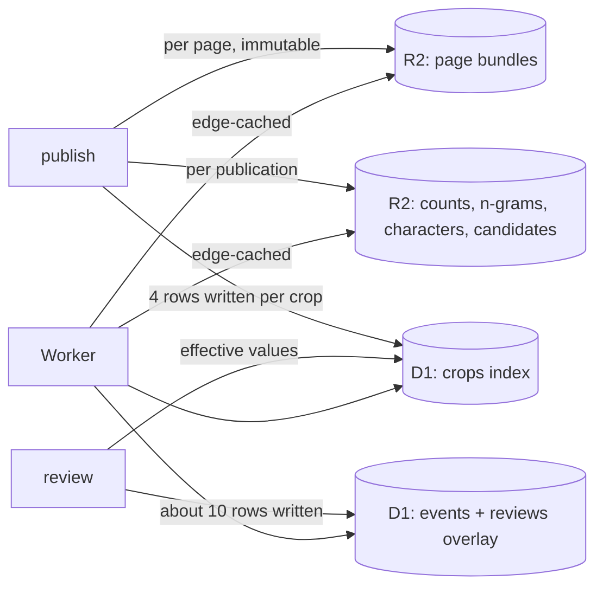

# 0005 Storage: a slim D1 index, page bundles in R2

Date: 2026-10-18

## The problem

D1 holds 8.96 GB of its 10 GB limit with about 0.53M local crops and 1.6M corpus glyphs. The
collector keeps a crop only when two models agree on it, which is 2.7M of the 12.7M characters it has
examined; keeping every aligned box for review takes the site to 10–15M crops. The present layout cannot
hold them:

- A `units` row averages 4.4 KB. `data` (1.3 KB) repeats the page and book on every crop, `context`
  (1.3 KB) is derivable from the line text, `snapshot` (0.9 KB) copies `data` again and `visual`
  (0.7 KB) repeats engine names and model hashes per row.
- `media` holds one row per image, about 140 B with its key index.
- `characters` is 495 MB of reference data that changes only when a publication does.
- A posted review fires a chain of triggers (`event_apply`, `unit_count_*`, `unit_mark_*`,
  `crop_version_*`, `current_claim_*`, `unit_ngram_*`, `ngram_*`) that writes 15–25 rows. A
  publication pays the same chain for every crop it touches, which is what put October's writes at four
  times the monthly allowance.
- Crop ids are derived from the box or the extraction run, so repairing a box or re-running the
  collector makes a new crop, and `unit_redirects`, `crop_versions` and `current_claim_recut` exist to
  follow it.

## The decision

The remote store is split by how often a thing changes.



### Identity

A crop's id is an integer, `page << 16 | slot`. Pages get integer ids in order of first publication.
The publisher assigns a slot once and never reuses it on the page. When a page is collected again, each
new box takes the slot of the old box it overlaps with IoU ≥ 0.5 and the same line; a box with no such
match gets a new slot, and an old slot left unmatched is retired. Each republication writes a match
report (slot, old box, new box, IoU) for every reviewed crop whose box moved.

Repairing a box keeps the id and increments the crop's `cut`. A claim rests on the `(id, cut)` it was
made against.

Corpus glyphs from external sets become crops on the same terms, with their source image as the page.
Public URLs write the id in Crockford base 32. The Vectorize index is rebuilt with these ids. Text ids
(`ex:…`, `hl:…`, `codh-omt:…`) stay in the page bundle and the collector's own store; old crop URLs stop
resolving.

### D1

```sql
CREATE TABLE crops(id INTEGER PRIMARY KEY, book INTEGER NOT NULL, char INTEGER, family INTEGER,
  production INTEGER, category INTEGER, style INTEGER, state INTEGER NOT NULL, quiz INTEGER NOT NULL,
  shuffle INTEGER NOT NULL, cut INTEGER NOT NULL DEFAULT 0, x INTEGER, y INTEGER, w INTEGER, h INTEGER);
CREATE INDEX crop_char ON crops(char, style, shuffle);
CREATE INDEX crop_family ON crops(family, style, shuffle);
CREATE INDEX crop_book ON crops(book, shuffle);
```

Strings live in small dictionary tables (`books`, `pages`, `graphemes` and the code tables for
production, category, style and state). The page's crops in reading order are a range scan on the
primary key, so there is no page index. No table holds a text crop id or an image hash, and `media` is
gone.

Measured on a 378,830-crop export, the layout with a text key and image hash took 238.8 B per crop. This
layout takes 105 B with the page index included, so about 90 B without it, or 1.4 GB at 15M crops. A
full build writes four rows per crop: 60M at 15M crops, and 8.5M for what is published today.

### Page bundles

Each page is one gzip JSON object in R2 under the publication's prefix: book, title, number, credit and
rights, page size and IIIF service, lines (text and box), and per crop its slot, line, box, label,
script, model votes, gate evidence, repair, and each cut's box with its image location (pack, offset,
size, digest). Measured at 53.8 B per crop gzipped, 0.8 GB at 15M crops.

Images keep their packs. A crop image URL is `/i/<id>-<digest>.webp`: the Worker takes the page from
the id, reads the bundle (edge-cached), and range-reads the pack. A recut changes the digest, so the
image stays immutable under its URL.

### Reviews

```sql
CREATE TABLE events(id INTEGER PRIMARY KEY, crop INTEGER NOT NULL, cut INTEGER NOT NULL,
  actor INTEGER NOT NULL, submission INTEGER NOT NULL, at INTEGER NOT NULL, kind INTEGER NOT NULL,
  patch TEXT NOT NULL);
CREATE INDEX event_crop ON events(crop);
CREATE INDEX event_actor ON events(actor, id);
CREATE TABLE reviews(crop INTEGER PRIMARY KEY, revision INTEGER NOT NULL, cut INTEGER NOT NULL,
  at INTEGER NOT NULL, char INTEGER, family INTEGER, state INTEGER NOT NULL, style INTEGER, mark INTEGER,
  base_char INTEGER, base_family INTEGER, base_state INTEGER NOT NULL, patch TEXT NOT NULL);
CREATE INDEX review_char ON reviews(char);
CREATE INDEX review_base_char ON reviews(base_char);
```

A review is one batch from the Worker, with no triggers: append the event, upsert the crop's
`reviews` row (the patch folded onto it, guarded by `revision`), and write the effective label, family,
state and style into `crops`. Galleries therefore read `crops` alone. Undo refolds the crop's
remaining events. A review writes about ten rows including index entries. `reviews` has a row only for
a crop a person has touched; quiz marks (hard, seen) live in its `mark` column.

A publication bakes reviewed values into the rows it uploads and sets `base_*` to them. Its upsert
prefers the overlay for any crop reviewed while the publication was being built. A reviewed crop whose
new box overlaps the reviewed cut by less than half is set to a `detached` state and listed in the
publication report.

The claim ledger (`assertions`, `assertion_*`, `current_claims`, `forms`, `representations`) keeps its
model with integer subjects and two indexes on `assertions` (slot, actor). Submissions, accounts and
favourites keep their tables, keyed by integer crop ids.

### Static data per publication

Counts, n-grams, character cards, variants, components, IDS, words, dating, document character lists,
quiz shapes, suspects, box-shape outliers and the gallery sample are written to R2 under the
publication's prefix and served through the edge cache. D1 keeps the columns the Worker searches by
text (character, name, alias). A count is the publication's figure plus the difference that `reviews`
makes to it: rows with `char = X` minus rows with `base_char = X`, both index reads.

### Candidates

A box that fails the extraction gate is kept with its gate evidence in its page bundle, and the
publication writes a per-character candidate list to R2. D1 has no row for a candidate. Confirming one
in review inserts its `crops` row and its `reviews` row.

### Cutover

The new layout is built offline into a fresh D1 database, a fresh R2 prefix and a fresh Vectorize
index. Reviews recorded after the export are replayed through the id map, review writes pause for the
final replay, and the Worker is deployed with the new bindings. The old database, prefix and index are
deleted a week later.

## Consequences

- Old crop links and the `units`, `media`, `unit_counts`, `unit_count_keys`, `unit_marks`,
  `crop_versions`, `unit_redirects`, `unit_ngrams`, `ngram_*`, `written_forms` and `pages` tables are
  deleted with the old database.
- A review's label reaches galleries and counts at once. N-gram counts change at the next publication.
- The risk is a slot match that moves a person's review onto a neighbouring glyph, the failure seen in
  the `ar:` block shift and the `hl:` line scramble. Before cutover, one reviewed book is republished
  through the matcher and every reviewed label is compared with its glyph; any move stops the cutover.
