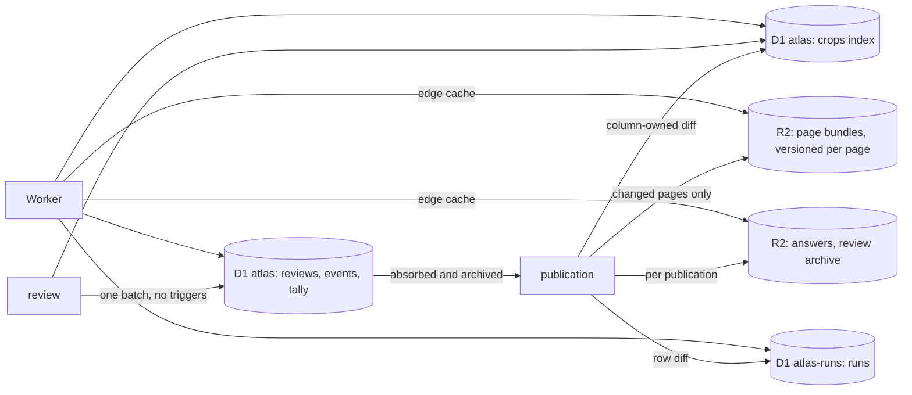

# 0005 Storage: a slim D1 index, page bundles in R2

Date: 2026-10-18

## The problem

D1 holds 8.96 GB of its 10 GB limit with about 0.53M collected crops and 1.6M corpus glyphs. Keeping
every aligned box for review takes the site to 10–15M crops plus about 8M candidates. The present
layout cannot hold them:

- A `units` row averages 4.4 KB. `data` repeats the page and book on every crop, `context` is
  derivable from the line text, `snapshot` copies `data` again and `visual` repeats engine names and
  model hashes per row. `media` adds 2.3 rows per crop.
- A review fires a trigger chain (`event_apply`, `unit_count_*`, `unit_mark_*`, `crop_version_*`,
  `current_claim_*`, `unit_ngram_*`, `ngram_*`) that writes 15–25 rows, and a publication pays the
  same chain for every crop it touches.
- Answers that only a publication changes are cached under `catalogueVersion`, which moves with every
  review, so they are recomputed constantly. Over seven days to 17 October the database ran 77M
  statements reading 5.3B rows; one withheld total alone was 47% of the rows read.
- Crop ids derive from the box or the extraction run, so a re-cut makes a new crop, and
  `unit_redirects`, `crop_versions` and `current_claim_recut` exist to follow it.

## The decision

Everything is stored by how often it changes. A publication writes immutable objects to R2 and
static rows to D1. Reviews write a small live layer in D1, and each publication absorbs that layer,
so D1 never accumulates review history. Static answers are cached under publication numbers, never
under review counters.



### Identity

- **Pages** get integer ids, allocated once and never derived from a position. The page's key (book
  and ordinal) is only the publisher's lookup; inserting or renumbering a page changes keys, not ids.
  IIIF canvas and image URLs are attributes in its bundle.
- **Crops** are `page << 24 | slot`, which stays below 2^53 for 536M pages. The Worker computes it
  with multiplication, since JavaScript bitwise operators are 32-bit.
  - Slots below 2^23 are assigned by the publisher. Slots from 2^23 up are assigned by the site from
    `pages.next_site_slot`, incremented in the same batch that inserts the box.
  - A slot is never reused. Both high-water marks live on `pages`, and a rebuilt publisher mirror
    takes them from D1.
- **Re-collecting a page.** New boxes are matched to old ones by a maximum one-to-one assignment on
  IoU, measured in page-normalised coordinates with no condition on the line. A pair counts at IoU ≥
  0.5; label agreement breaks ties.
  - The old box is the effective one: a box redrawn in review is matched as redrawn.
  - Site-made boxes take part, so the publisher adopts them under their own slots.
  - A box with no match gets a new slot. An unmatched slot that nobody reviewed is retired.
  - A reviewed slot is never retired or moved silently. If a reviewed slot finds no match, or matches
    a box with a different label, the page keeps its current revision and goes to a quarantine list
    with the match report (slot, old box, new box, IoU, labels). The publication continues without it.
- **Repairs.** Repairing a box keeps the id and increments `cut`. A claim rests on `(id, cut)`.
- **Corpus glyphs** from external sets are crops on the same terms. Their slots are assigned in
  append-only import order on synthetic pages of a few hundred; the upstream id is an attribute, so
  an upstream release that inserts a glyph renumbers nothing.
- **Productions** have stable integer ids. The tree (a few thousand rows) is held in isolate memory,
  and a subtree filter becomes a list of ids. Adding a collection rewrites no crop.
- **Old and retired ids.** Text ids (`ex:…`, `hl:…`, `codh-omt:…`) and retired integer ids resolve
  through alias files in R2, sharded by hash prefix so a redirect is one small read. Issued citations
  keep resolving.
- **Public URLs** write the integer id in Crockford base 32.
- **`shuffle`** is a 31-bit mixing hash of the id, so republication never rewrites it and it stores
  in four bytes. Ties break by id.

### D1 `atlas`

```sql
CREATE TABLE crops(id INTEGER PRIMARY KEY,
  kind INTEGER NOT NULL,          -- collected, corpus, candidate
  book INTEGER NOT NULL, char INTEGER, form INTEGER, cluster INTEGER, visual_group INTEGER,
  production INTEGER, category INTEGER, style INTEGER, state INTEGER NOT NULL, quiz INTEGER NOT NULL,
  year INTEGER,                   -- witness year of the book, for year order and ranges
  shuffle INTEGER NOT NULL, cut INTEGER NOT NULL DEFAULT 0,
  revision INTEGER NOT NULL DEFAULT 0,
  flags INTEGER NOT NULL DEFAULT 0); -- suspect, irregular, reported
CREATE INDEX crop_char ON crops(char, kind, style, shuffle, id, quiz, state) WHERE kind < 2;
CREATE INDEX crop_year ON crops(char, kind, year, shuffle, id, style, quiz, state) WHERE kind < 2 AND year IS NOT NULL;
CREATE INDEX crop_book ON crops(book, shuffle, id) WHERE kind < 2;
CREATE INDEX crop_pending ON crops(production, shuffle, id) WHERE kind = 0 AND state = 0 AND quiz = 1;
CREATE INDEX crop_backlog ON crops(shuffle, id, production) WHERE kind = 0 AND state = 0 AND quiz = 1;
CREATE INDEX crop_candidate ON crops(char, shuffle, id) WHERE kind = 2;
CREATE INDEX crop_attention ON crops(char, book) WHERE flags <> 0;
CREATE TABLE pages(id INTEGER PRIMARY KEY, key TEXT NOT NULL UNIQUE, book INTEGER NOT NULL,
  rev INTEGER NOT NULL, next_slot INTEGER NOT NULL DEFAULT 0, next_site_slot INTEGER NOT NULL DEFAULT 8388608);
CREATE TABLE books(id INTEGER PRIMARY KEY, key TEXT NOT NULL UNIQUE);
CREATE TABLE graphemes(id INTEGER PRIMARY KEY, text TEXT NOT NULL UNIQUE, head INTEGER);
CREATE INDEX grapheme_head ON graphemes(head);
CREATE TABLE names(text TEXT, code_point INTEGER, rank INTEGER, PRIMARY KEY(text, code_point)) WITHOUT ROWID;
```

- **Galleries.** A character gallery is one `crop_char` range in the order it shows, style then
  shuffle, with or without withheld crops (`quiz`) and with any state filter read from the index;
  the index covers every gallery query, so no query sorts or reads the table. Pages are keyset
  cursors on `(style, shuffle, id)`, or `(year, shuffle, id)` for year order. A query repeats the
  partial-index condition (`kind < 2`) literally, or SQLite scans the table.
- **Families.** A grapheme family has no column. Its gallery reads one bounded range per member
  character and merges them in the Worker, so regrouping characters rewrites no crop. Family
  galleries are about 1% of gallery reads.
- **The review queue** reads `crop_pending` for one production and `crop_backlog`, in shuffle order
  with the production as a filter and named by `INDEXED BY`, for the whole backlog or a large
  subtree.
- **Flagged crops** are read with `flags <> 0` written in the query, so the planner uses
  `crop_attention`.
- **Boxes** are not in `crops`. A cut's box lives in the bundle and a redrawn box in `reviews`.
- **Candidates** have rows from the start and are kept out of the gallery indexes, so the review
  queue for a character is one index range. Confirming one sets its `kind` and moves it into the
  galleries.

```sql
CREATE TABLE events(id INTEGER PRIMARY KEY, crop INTEGER NOT NULL, revision INTEGER NOT NULL,
  cut INTEGER NOT NULL, gen INTEGER NOT NULL, actor INTEGER NOT NULL, submission INTEGER NOT NULL,
  at INTEGER NOT NULL, kind INTEGER NOT NULL,
  label INTEGER, state INTEGER, style INTEGER, quiz INTEGER, x INTEGER, y INTEGER, w INTEGER, h INTEGER,
  note TEXT CHECK(length(note) <= 2000), UNIQUE(crop, revision));
CREATE INDEX event_actor ON events(actor, id);
CREATE TABLE reviews(crop INTEGER PRIMARY KEY, gen INTEGER NOT NULL, at INTEGER NOT NULL,
  char INTEGER, state INTEGER NOT NULL, style INTEGER, quiz INTEGER, mark INTEGER,
  x INTEGER, y INTEGER, w INTEGER, h INTEGER,
  base_char INTEGER, base_state INTEGER, base_style INTEGER, base_quiz INTEGER);
CREATE TABLE skips(crop INTEGER, actor INTEGER, cut INTEGER, at INTEGER,
  PRIMARY KEY(crop, actor)) WITHOUT ROWID;
CREATE INDEX skip_actor ON skips(actor, at);
CREATE TABLE generation(id INTEGER PRIMARY KEY CHECK(id = 0), gen INTEGER NOT NULL);
CREATE TABLE tally(gen INTEGER, kind INTEGER, char INTEGER, book INTEGER, production INTEGER,
  style INTEGER, state INTEGER, quiz INTEGER, n INTEGER NOT NULL,
  PRIMARY KEY(gen, char, kind, book, production, style, state, quiz)) WITHOUT ROWID;
CREATE TABLE actor_stats(actor INTEGER PRIMARY KEY, reviews INTEGER, rounds INTEGER, at INTEGER);
```

`tally` key columns write -1 for an unknown value, since a `WITHOUT ROWID` key cannot hold NULL and 0 is a real code.

- **Two writers, one rule.** Reviews own `char`, `state`, `style`, `quiz`, `kind` (confirming a
  candidate) and `flags`; the publisher owns the rest. A publisher update that touches a
  review-owned column carries `WHERE revision = ?` with the revision it read. A crop reviewed since
  then fails the guard and waits for the next publication.
- **A review** is one batch from the Worker:
  - insert the event with `revision` set to `(SELECT revision + 1 FROM crops WHERE id = ? AND
    revision = ? AND cut = ?)`, so a stale revision or cut writes NULL into a NOT NULL column and
    aborts the batch; `gen` comes from `generation` in the same statement;
  - update `crops` with the effective values and the new revision;
  - upsert `reviews`, keeping the published values in `base_*`;
  - move one count in `tally` from the old cell to the new, in the current generation, with
    `ON CONFLICT DO UPDATE SET n = n + excluded.n`;
  - bump `actor_stats`.

  The batch also clears flags whose premise it changed: a new label or box clears `suspect` and
  `irregular`. A redrawn box is fetched once from the page's IIIF image service and stored in R2
  under `overrides/<id>-<revision>.jpg`, which galleries show until the next publication cuts it.
- **Absorbing a publication.** The publication bumps `generation` from G to G + 1 in one statement,
  then reads every event with `gen ≤ G`. Batches run in order on the primary, so no review writes
  generation G after the bump. The publication builds its answers and bundles from those events,
  goes live with the pointer `(pub, through_gen = G)`, and after the previous prefix expires
  deletes the `reviews` and `tally` rows with `gen ≤ G`. Counts are the publication's R2 answer plus
  the `tally` rows above `through_gen`, so `reviews` and `tally` only ever hold the reviews since the
  last publication.
- **The review archive.** Each publication writes the events it absorbed to R2 under
  `events/<actor>/<month>.jsonl.gz`, and a crop index under `events/crops/<page>.jsonl.gz`. D1 keeps
  90 days of events for recent history, the per-actor totals and skips younger than 90 days. Every
  D1 table can be rebuilt from R2 and the publisher's data.
- **Kept, with integer ids:** the claim ledger (`assertions` with two indexes, `assertion_*`,
  `current_claims` with `cut`), forms tool decisions, submissions, accounts and favourites. A crop's
  current form is written into `crops.form` by the claim that sets it. Each publication archives the
  ledger to R2 as well.
- **Read replication.** A reviewer's reads after a save go through the D1 Sessions API with the
  save's bookmark and bypass the edge cache; only anonymous reads are edge-cached.

### D1 `atlas-runs`

Runs of two and three crops are static between publications. They live in their own database, so their
growth never competes with review state for the 10 GB.

```sql
CREATE TABLE runs(size INTEGER, graphemes TEXT, hand INTEGER, shuffle INTEGER, first INTEGER,
  second INTEGER, third INTEGER, book INTEGER,
  PRIMARY KEY(size, graphemes, hand, shuffle, first)) WITHOUT ROWID;
CREATE INDEX run_book ON runs(size, graphemes, book, first);
CREATE INDEX run_first ON runs(first);
CREATE INDEX run_second ON runs(second) WHERE size = 2;
CREATE TABLE run_stats(size INTEGER, graphemes TEXT, n INTEGER, down INTEGER,
  PRIMARY KEY(size, graphemes)) WITHOUT ROWID;
CREATE INDEX run_rank ON run_stats(size, n);
```

- A run's line text and direction come from its page bundle. Hands, works, written forms and
  related runs are R2 answers per run, and book-scope counts are in each book's R2 answer.
- **Runs of four to eight** anchor on their rarest three-crop run by `run_stats.n`, then extend pair
  by pair in both directions through `run_first` and `run_second`, joining on crop ids. Their
  counts are capped, as today.
- **Order between databases.** A publication writes `atlas` before `atlas-runs`, and the Worker drops
  run rows whose crops it cannot find.

### R2

- `pages/<page>-<rev>.json.gz`: book, number, credit and rights, page size, IIIF service, lines (text,
  box, direction, image place), and per crop its source id, line, label, script, votes, gate
  evidence, repair and every cut's box and image place. Candidates sit in the same list, marked as
  candidates. `pages/<page>-<rev>.cuts` is a table of `(slot, cut, image place)` sorted by slot and
  cut, read by binary search over range reads.
- `pub/<pub>/…`, written whole per publication: rendered answers, which are character totals by
  state, counts by style, top books, chronology by decade with capped samples, browse facets and
  totals, the browse sample pool, character cards (variants, derived forms, words, IDS), books with
  both dating axes and their run counts, run details, forms tool lists and the alias shards.
- `pointer.json`: `(pub, through_gen)`, moved last.
- Packs hold crop and line images, unchanged.

A crop image is `/i/<id>-<rev>-<cut>.webp`. The page that lists the crop knows its page's `rev`, so
the image route reads no D1: it takes the page from the id, reads `.cuts` and range-reads the pack,
and the response is immutable. A bundle stays readable for a week after its page moves to a newer
revision.

### Similar crops

Vectorize allows 20M vectors per index. Vectors are sharded by page-id range, and growth opens a
new shard. A vector's metadata carries its kind, character and style, with their metadata indexes created
before the first insert. Vectorize changes metadata only by an upsert that resends the vector, so
confirming a candidate is an upsert of its vector, from the publisher's copy, in the same shard. A change
is queryable within about two minutes. Search queries the shards in parallel and merges, then checks each result against `crops`.
A re-cut overwrites the crop's vector.

### Publication

- **Changed pages only.** A publication writes only the pages whose content changed. Per page, it
  uploads the bundle and `.cuts`, then sends the page's rows and its `rev` in one batch, so a reader
  sees either the old page or the new one.
- **Row diff.** The publisher keeps a local mirror of every table it owns and sends inserts, updates
  and deletes from the diff, limited to the columns it owns. An upsert carries `WHERE` clauses that
  skip unchanged rows, because D1 bills an unchanged upsert as a write.
- **Global objects** under `pub/<pub>/` are written after every page batch has applied, then
  `pointer.json` moves. The previous prefix stays readable for a week, longer than any edge cache
  lifetime.

## Measured and estimated cost

- **D1 `crops`.** A slim table measured 105 B per crop with four indexes on a 378,830-crop export.
  This layout drops the box columns and adds `kind`, `year`, `visual_group`, `form`, `cluster` and
  `revision`; it is to be measured before cutover. At 15M collected and corpus crops plus 8M
  candidates, the estimate is 2.5–3 GB.
- **Review tables** hold only the reviews since the last publication and 90 days of events: well
  under 1 GB at tens of thousands of reviews a day.
- **Page bundles:** 54 B per crop gzipped.
- **Rows written.** D1 bills one written row per table row and one per index entry the write
  touches.
  - The one-off full build at 15M crops is about 60M rows for crops (table and three indexes), 16M
    for candidates and 30M for runs, spread over two billing months.
  - A review writes about 15–20 rows with index entries, to be measured.
  - A publication writes the row diff. A publication that re-cuts every box of a set rewrites `cut`
    on each of its crops, so such re-cuts are scheduled against the monthly allowance.

## Before cutover

1. Build the layout from the export and run every workload pattern against a 15M-crop synthetic with
   `EXPLAIN QUERY PLAN`, recording rows read and Worker CPU per request. The synthetic follows the
   real character frequencies. Include the most frequent characters, large families, optional
   filters, deep pages, the whole review backlog, long runs and cold image requests.
2. Size everything that stays in D1: crops and candidates, the claim ledger, submissions, accounts,
   favourites, review tables at the measured review rate. The total keeps 30% of the 10 GB free.
   `atlas-runs` stays under 4 GB, or its postings move to R2 before any run row is loaded.
3. Run the slot matcher over every reviewed book, and on synthetic cases: page-wide shifts, shifted
   lines, split and merged boxes, inserted pages, corpus re-imports. The report counts reviewed
   crops whose glyph, label or centre would change. No reviewed slot may move or retire.
4. Race reviews against a publication's generation bump and page batches, and compare the counts
   with totals recomputed from the events.
5. Measure rows written per review and per publication on live traffic.
6. Time a full rebuild of D1 from R2 and the publisher's data.

## Consequences

- Deleted with the old database: `units`, `corpus_units`, `media`, `pages`, `unit_counts`,
  `unit_count_keys`, `unit_marks`, `crop_versions`, `unit_redirects`, `written_forms`, `unit_ngrams`,
  `ngram_*`, `form_units`, `document_dating` and the publication-keyed caches.
- A review shows in galleries and counts at once. Run counts and chronology change at the next
  publication.
- D1 is an index rebuilt from R2 and the publisher's data, so a later schema change is a rebuild
  script.
- The risk is a slot match that moves a person's review onto a neighbouring glyph, the failure seen in
  the `ar:` block shift and the `hl:` line scramble. One-to-one matching, the quarantine and the
  rehearsal guard it.
