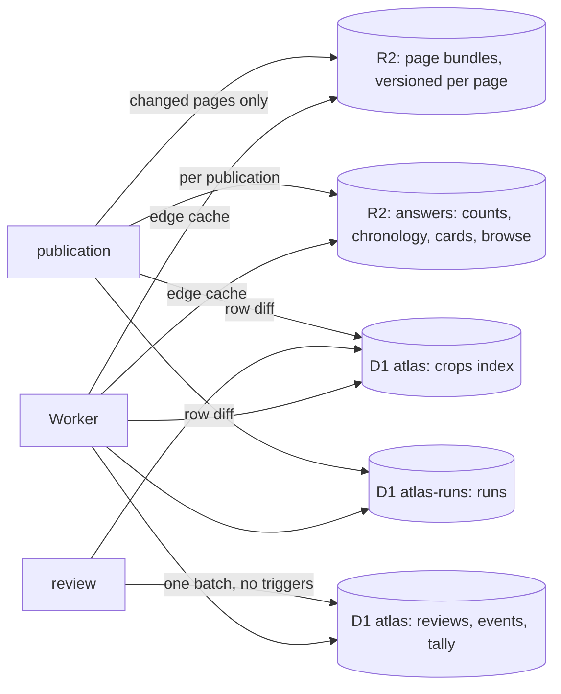

# 0005 Storage: a slim D1 index, page bundles in R2

Date: 2026-10-18

## The problem

D1 holds 8.96 GB of its 10 GB limit with about 0.53M collected crops and 1.6M corpus glyphs. Keeping
every aligned box for review takes the site to 10–15M crops plus about 8M candidates. The present
layout cannot hold them:

- A `units` row averages 4.4 KB. `data` repeats the page and book on every crop, `context` is
  derivable from the line text, `snapshot` copies `data` again and `visual` repeats engine names and
  model hashes per row. `media` adds 2.3 rows per crop.
- A review fires a trigger chain (`event_apply`, `unit_count_*`, `unit_mark_*`, `crop_version_*`,
  `current_claim_*`, `unit_ngram_*`, `ngram_*`) that writes 15–25 rows, and a publication pays the
  same chain for every crop it touches.
- Answers that only a publication changes are cached under `catalogueVersion`, which moves with every
  review, so they are recomputed constantly. Over seven days to 17 October the database ran 77M
  statements reading 5.3B rows; one withheld total alone was 47% of the rows read.
- Crop ids derive from the box or the extraction run, so a re-cut makes a new crop, and
  `unit_redirects`, `crop_versions` and `current_claim_recut` exist to follow it.

## The decision

Everything is stored by how often it changes. A publication writes immutable objects to R2 and
static rows to D1. Reviews write a small live layer in D1. Static answers are cached under
publication numbers, never under review counters.



### Identity

- **Pages** get integer ids. A page's key belongs to the project (book and ordinal). IIIF canvas and
  image URLs are attributes in its bundle, so a holder moving its manifests changes no id.
- **Crops** are `page << 24 | slot`, which stays below 2^53 for 536M pages.
  - Slots below 2^23 are assigned by the publisher. Slots from 2^23 up are assigned by the site, for
    boxes people add or split.
  - A slot is never reused.
- **Re-collecting a page.** Each new box takes the slot of the old box it overlaps with IoU ≥ 0.5,
  measured in page-normalised coordinates with no condition on the line.
  - Site-made boxes take part in the match, so the publisher adopts them under their own slots.
  - A box with no match gets a new slot, and an unmatched old slot is retired.
  - Each publication reports every reviewed crop whose box moved: slot, old box, new box, IoU.
- **Repairs.** Repairing a box keeps the id and increments `cut`. A claim rests on `(id, cut)`.
- **Corpus glyphs** from external sets are crops on the same terms. Each source's glyphs are grouped
  into synthetic pages of a few hundred, and their identity is the upstream id.
- **Text ids** (`ex:…`, `hl:…`, `codh-omt:…`) live in the bundles. Each set also has a sorted alias
  file in R2, which the `/crop/<text id>` route reads to redirect, so issued citations keep resolving.
- **Public URLs** write the integer id in Crockford base 32.
- **`shuffle`** is a pure function of the id, so republication never rewrites it.

### D1 `atlas`

```sql
CREATE TABLE crops(id INTEGER PRIMARY KEY,
  kind INTEGER NOT NULL,          -- collected, corpus, candidate
  book INTEGER NOT NULL, char INTEGER, form INTEGER, cluster INTEGER, visual_group INTEGER,
  production INTEGER, category INTEGER, style INTEGER, state INTEGER NOT NULL, quiz INTEGER NOT NULL,
  year INTEGER,                   -- witness year of the book, for year order and ranges
  shuffle INTEGER NOT NULL, cut INTEGER NOT NULL DEFAULT 0,
  flags INTEGER NOT NULL DEFAULT 0); -- suspect, irregular, reported, detached
CREATE INDEX crop_char ON crops(char, kind, quiz, style, shuffle) WHERE kind < 2;
CREATE INDEX crop_year ON crops(char, kind, year, shuffle) WHERE kind < 2 AND year IS NOT NULL;
CREATE INDEX crop_book ON crops(book, shuffle) WHERE kind < 2;
CREATE INDEX crop_pending ON crops(production, shuffle) WHERE kind = 0 AND state = 0 AND quiz = 1;
CREATE INDEX crop_candidate ON crops(char, shuffle) WHERE kind = 2;
CREATE INDEX crop_attention ON crops(char, book) WHERE flags <> 0;
CREATE TABLE pages(id INTEGER PRIMARY KEY, key TEXT NOT NULL UNIQUE, book INTEGER NOT NULL, rev INTEGER NOT NULL);
CREATE TABLE books(id INTEGER PRIMARY KEY, key TEXT NOT NULL UNIQUE);
CREATE TABLE graphemes(id INTEGER PRIMARY KEY, text TEXT NOT NULL UNIQUE, head INTEGER);
CREATE TABLE names(text TEXT, code_point INTEGER, rank INTEGER, PRIMARY KEY(text, code_point)) WITHOUT ROWID;
```

- **Galleries.** A family has no column of its own. A gallery for a grapheme family expands the
  family to its member characters from `graphemes` and merges one `crop_char` range per member, so
  regrouping characters rewrites no crop.
- **Production codes** are assigned in depth-first order, so a subtree is a contiguous range; the
  publisher checks this on every publication.
- **Boxes** are not in `crops`. A cut's box lives in the bundle and a redrawn box in `reviews`.
- **Candidates** have rows from the start and are kept out of the gallery indexes, so the review
  queue for a character is one index range. Confirming one sets its `kind` and moves it into the
  galleries.

```sql
CREATE TABLE events(crop INTEGER NOT NULL, revision INTEGER NOT NULL, seq INTEGER NOT NULL UNIQUE,
  actor INTEGER NOT NULL, submission INTEGER NOT NULL, at INTEGER NOT NULL, kind INTEGER NOT NULL,
  label INTEGER, state INTEGER, style INTEGER, quiz INTEGER, x INTEGER, y INTEGER, w INTEGER, h INTEGER,
  note TEXT, PRIMARY KEY(crop, revision)) WITHOUT ROWID;
CREATE INDEX event_actor ON events(actor, seq);
CREATE INDEX event_at ON events(at, seq);
CREATE TABLE reviews(crop INTEGER PRIMARY KEY, revision INTEGER NOT NULL, cut INTEGER NOT NULL, at INTEGER NOT NULL,
  char INTEGER, state INTEGER NOT NULL, style INTEGER, quiz INTEGER, mark INTEGER, skips INTEGER NOT NULL DEFAULT 0,
  x INTEGER, y INTEGER, w INTEGER, h INTEGER,
  base_char INTEGER, base_state INTEGER, base_style INTEGER, base_quiz INTEGER);
CREATE TABLE skips(crop INTEGER, actor INTEGER, cut INTEGER, submission INTEGER, at INTEGER,
  PRIMARY KEY(crop, actor)) WITHOUT ROWID;
CREATE INDEX skip_actor ON skips(actor, at);
CREATE TABLE tally(gen INTEGER, char INTEGER, book INTEGER, production INTEGER, style INTEGER, state INTEGER,
  quiz INTEGER, n INTEGER NOT NULL, PRIMARY KEY(gen, char, book, production, style, state, quiz)) WITHOUT ROWID;
CREATE TABLE actor_stats(actor INTEGER PRIMARY KEY, reviews INTEGER, rounds INTEGER, at INTEGER);
```

- **A review** is one batch from the Worker:
  - append the event, keyed by `(crop, revision)`, so a stale revision fails the batch;
  - upsert `reviews`, keeping the pre-review values in `base_*`;
  - write the effective values into `crops`;
  - move one count in `tally` from the old cell to the new;
  - bump `actor_stats`.

  That is about twelve rows written. The batch also clears flags whose premise it changed: a new label
  or box clears `suspect` and `irregular`.
- **Counts** are the publication's R2 answer plus the `tally` rows of generations newer than that
  publication. A publication opens a new generation before it snapshots, absorbs everything older
  into its R2 answers, and deletes those rows after it goes live. Between publications `tally` holds a
  few thousand rows.
- **Older events.** A publication seals events older than 90 days into R2 under
  `events/<pub>/<actor>.jsonl.gz`. D1 keeps recent history and the per-actor totals.
- **Kept, with integer ids:** the claim ledger (`assertions` with two indexes, `assertion_*`,
  `current_claims` with `cut`), forms tool decisions, submissions, accounts and favourites. A crop's
  current form is written into `crops.form` by the claim that sets it.
- **Read replication.** A reviewer's reads after a save go through the D1 Sessions API with the
  save's bookmark.

### D1 `atlas-runs`

Runs of two and three crops are static between publications. They live in their own database, so their
growth never competes with review state for the 10 GB.

```sql
CREATE TABLE runs(size INTEGER, graphemes TEXT, hand INTEGER, shuffle INTEGER, first INTEGER,
  second INTEGER, third INTEGER, book INTEGER, text TEXT, vertical INTEGER,
  PRIMARY KEY(size, graphemes, hand, shuffle, first)) WITHOUT ROWID;
CREATE INDEX run_book ON runs(size, graphemes, book, first);
CREATE INDEX run_first ON runs(first) WHERE size = 2;
CREATE INDEX run_second ON runs(second) WHERE size = 2;
CREATE TABLE run_stats(scope INTEGER, size INTEGER, graphemes TEXT, n INTEGER, down INTEGER,
  hands TEXT, works TEXT, forms TEXT, related TEXT, PRIMARY KEY(scope, size, graphemes)) WITHOUT ROWID;
CREATE INDEX run_rank ON run_stats(scope, size, n);
```

Runs of four to eight are chained through `run_first` and `run_second`, and a page's runs are found
through `run_first`, since its crop ids share the page prefix. `hands`, `works`, `forms` and `related`
are filled on site-scope rows only, and book-scope rows hold counts.

### R2

- `pages/<page>-<rev>.json.gz`: book, number, credit and rights, page size, IIIF service, lines (text,
  box, image place), and per crop its source id, line, label, script, votes, gate evidence, repair
  and every cut's box and image place. Candidates sit in the same list, marked as candidates.
  `pages/<page>-<rev>.cuts` is a fixed-width table of cut image places, so the image route does one
  small range read.
- `pub/<pub>/…`, written whole per publication: rendered answers, which are character totals by state,
  counts by style, top books, chronology by decade with capped samples, browse facets and totals, the
  browse sample pool, character cards (variants, derived forms, words, IDS), books with both dating
  axes, forms tool lists and the text-id alias files.
- Packs hold crop and line images, unchanged.

A crop image is `/i/<id>-<cut>.webp`. The Worker takes the page from the id, reads its `rev` and
`.cuts` (both edge-cached) and range-reads the pack. A box redrawn in review is served from the page's
IIIF image service until the next publication cuts it.

### Similar crops

Vectorize allows 20M vectors per index. Collected and corpus crops go in one index and candidates in
another, both with integer ids. Search goes through one accessor that picks the index from the crop's
kind.

### Publication

- **Changed pages only.** A publication writes only the pages whose content changed, in this order:
  bundle, then rows, then the page's `rev`. A reader never sees rows whose images do not exist yet.
- **Row diff.** The publisher keeps a local mirror of every table it owns and sends inserts, updates
  and deletes from the diff. An upsert carries `WHERE` clauses that skip unchanged rows, because D1
  bills an unchanged upsert as a write.
- **Global objects** under `pub/<pub>/` are written before `pub` moves, and the previous prefix stays
  readable for a day.

## Measured and estimated cost

- **D1 `crops`.** A slim table measured 105 B per crop with four indexes on a 378,830-crop export.
  This layout drops the box columns and adds `kind`, `year`, `visual_group`, `form` and `cluster`; it
  is to be measured before cutover. At 15M collected and corpus crops plus 8M candidates, the estimate
  is 2.5–3 GB.
- **Review tables** at 15M reviewed crops: about 5 GB with events sealed after 90 days. The limit
  that matters here is the event volume, so it is measured on live traffic before cutover.
- **Page bundles:** 54 B per crop gzipped.
- **Rows written:**
  - the one-off full build at 15M crops is about 60M for crops, 32M for candidates and 30M for runs,
    spread over two billing months;
  - a review writes about twelve rows;
  - a publication writes the row diff.

## Before cutover

1. Build the layout from the export and run every workload pattern against a 15M-crop synthetic,
   recording rows read and Worker CPU per request.
2. Rehearse the slot matcher on one reviewed book. If any review moves, the cutover stops.
3. Measure bytes per review in `reviews`, `events`, `skips` and `tally` on live traffic.

## Consequences

- Deleted with the old database: `units`, `corpus_units`, `media`, `pages`, `unit_counts`,
  `unit_count_keys`, `unit_marks`, `crop_versions`, `unit_redirects`, `written_forms`, `unit_ngrams`,
  `ngram_*`, `form_units`, `document_dating` and the publication-keyed caches.
- A review shows in galleries and counts at once. N-gram counts change at the next publication.
- The risk is a slot match that moves a person's review onto a neighbouring glyph, the failure seen in
  the `ar:` block shift and the `hl:` line scramble. The match report and the rehearsal guard it.
